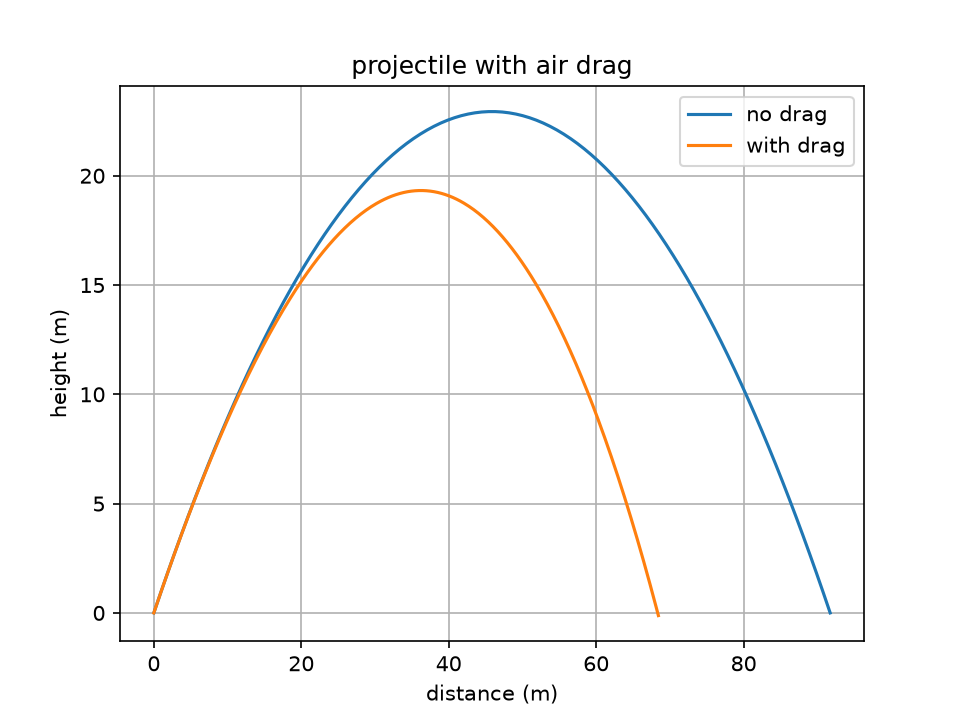

# Physics Simulations

Python simulations of projectile and orbital motion using NumPy and Matplotlib.

## Projects
- projectile.py: projectile motion without air resistance
- projectile_drag.py: projectile motion with air drag, compared against the no-drag path
- orbit_simulation.py: satellite orbits under gravity at different launch speeds

## Method
- projectile.py: analytical (exact) solution
- projectile_drag.py and orbit_simulation.py: numerical Euler integration
  (semi-implicit for orbits: velocity updated before position)

## Results

### Projectile with air drag

Air drag shortens the range and lowers the peak height compared with the ideal path.

### Satellite orbits

- 1.0 × circular speed: stable circular orbit
- 1.3 × circular speed: elliptical orbit
- 1.5 × circular speed: exceeds escape speed (about 1.41×), so the satellite leaves Earth
- 0.8 × circular speed: too slow, the satellite falls back to Earth

## How to run
pip install numpy matplotlib
python orbit_simulation.py
## Tools
Python, NumPy, Matplotlib
