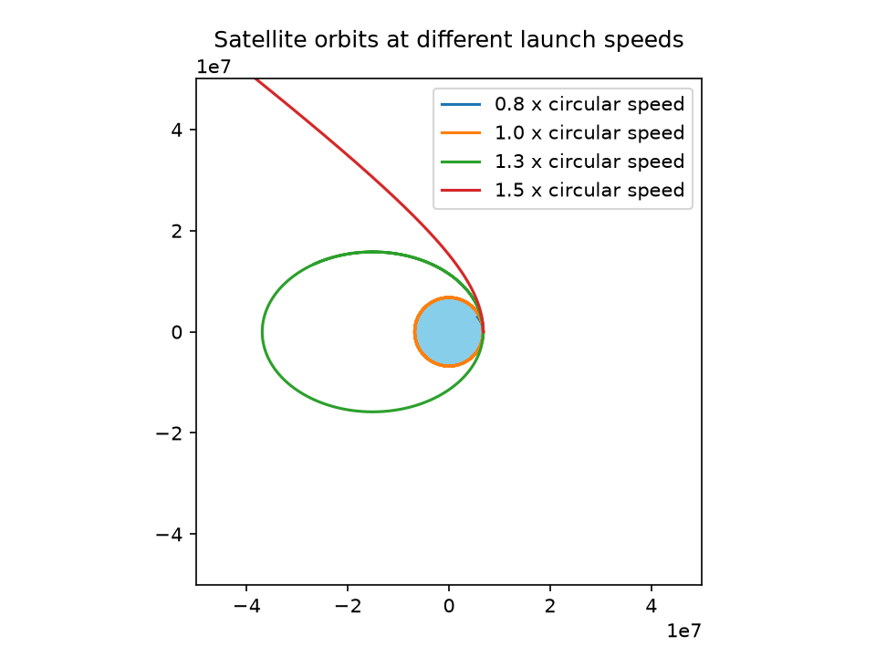

# Physics Simulations

Python simulations of projectile and orbital motion using NumPy and Matplotlib.

## Projects
- projectile_motion.py – projectile motion without air resistance
- projectile_drag.py – projectile motion with air drag
- orbit_simulation.py – satellite orbits under gravity at different launch speeds

## Method
Euler integration (semi-implicit for orbits: velocity updated before position).

## Results

- 1.0 × circular speed: stable circular orbit
- 1.3 × circular speed: elliptical orbit
- 1.5 × circular speed: exceeds escape speed (about 1.41×), satellite leaves Earth
- 0.8 × circular speed: too slow, satellite falls back to Earth

## Run
pip install numpy matplotlib
python orbit_simulation.py
